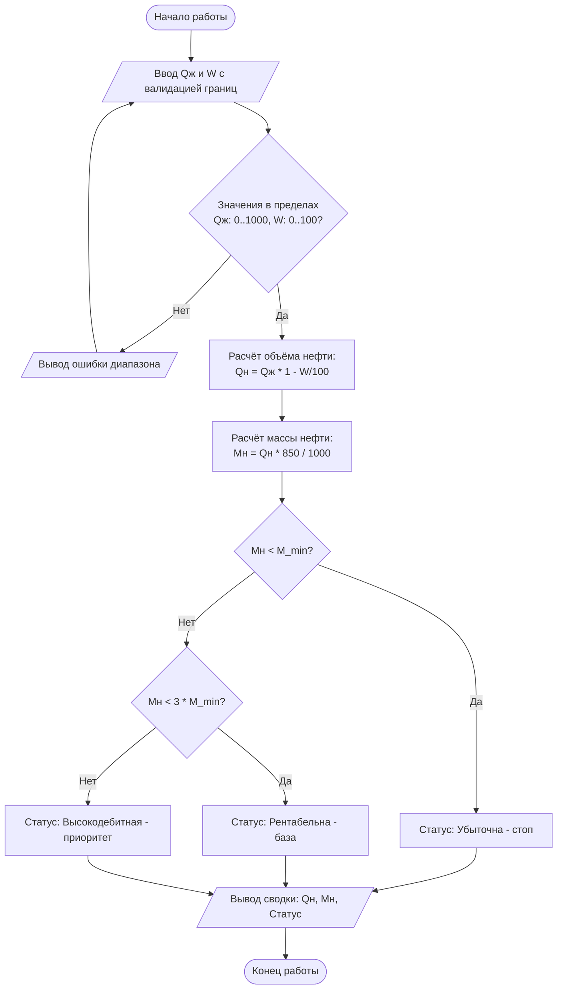

1. read_valid_param(prompt, min_val, max_val) — циклический запрос и валидация одного числа в
границах;
 2. calc_oil_volume(q_liq, w_pct) — расчёт объёмного дебита нефти Qн = Qж * (1 - W / 100);
• 3. calc_oil_mass(q_oil, density) — перевод объёма нефти в тонны Mн = Qн * плотность / 1000;
 4. evaluate_profitability(m_oil, m_min) — классификация статуса рентабельности через if-elif-else.

